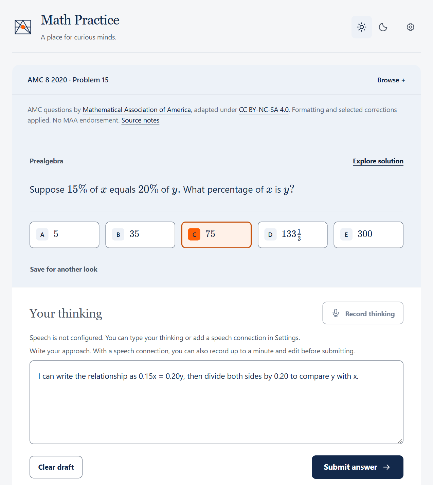
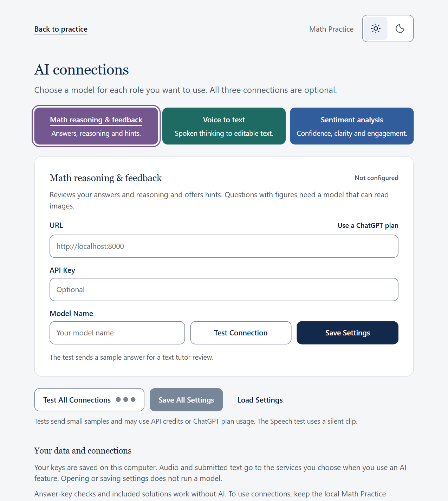

# K-12-Math knowledge graph, questions and practice UI

[](database/knowledge-graph/source/metadata.json)
[](database/cn-math-bank/VERSION)
[](database/amc-bank/VERSION)
[](math-practice/VERSION)

K-12-math is a mathematics study collection with **936 knowledge graph nodes (knowledge items), 3,355 Chinese curriculum questions, and 5,435 AMC questions**. Students can follow the Chinese curriculum, browse US Common Core standards, or explore concepts through the grade-independent **ailleo** map. A question can connect to several concepts, and different solution methods can use different sets of concepts.

## What’s in the repository

| Component | Version | Contents |
|---|---|---|
| [Mathematics knowledge graph](database/knowledge-graph/) | 1.0.0 | Connects 936 concepts through 1,634 accepted relationships and links questions to the concepts they assess or use in a solution. |
| [Chinese curriculum question bank](database/cn-math-bank/) | 2.0.0 | Contains 3,355 questions in English with answers and worked solutions, alongside the original Chinese material. |
| [AMC question bank](database/amc-bank/) | 2.3.0 | Contains 5,435 questions and answer keys from 195 competition papers, with stored worked solutions for 4,567 questions, including all 4,210 questions from 1950 through 2016. |
| [Math Practice UI](math-practice/) | 2.1.2 | Runs locally so students can browse either bank, explain their thinking, and practice with optional model feedback. |

All 8,790 questions have graph annotations. For 8,780, the annotation identifies an assessed concept or a solution route. The other ten link to definitions for context. The 7,922 solved questions contain 8,631 written methods. Of these questions, 709 have more than one written method, and 200 AMC questions include an adaptation of an official MAA solution. The question banks identify the sources of their explanations.

## Practice with the collection

With Python 3.11 or newer installed, run this command from the repository root. On Windows, you can also use [Start Math Practice.cmd](<Start Math Practice.cmd>).

```sh
python math-practice/runtime/serve_math_practice.py
```

Open [Math Practice on your computer](http://127.0.0.1:8877/math-practice/). Choose a map or a question bank, open a problem, and enter an answer. Browsing, answer-key checks, and stored solutions work offline.

| 1. Practice a question | 2. Choose the model for each task |
|:---:|:---:|
| [](math-practice/images/question-page.png) | [](math-practice/images/model-settings.png) |

Students can type their reasoning or record it, edit the transcript, and submit it with their answer. In **Settings → Connection settings**, each of three optional roles can use its own provider. For example, use an OpenAI account for math and local models for the other two:

- **Math reasoning and feedback** checks the submitted answer and explanation together. If either has a problem, the tutor explains where and can offer a hint.
- **Voice to text** transcribes the recording into a draft the student can edit.
- **Sentiment analysis** reads the original transcript for expressed confidence, engagement, and how clearly the student explained their reasoning. It does not grade the math or analyze vocal tone.

See [UI and model setup](math-practice/README.md#optional-ai-connections) for supported APIs and local model settings.

## Further development and custom question banks

All 7,922 questions with stored worked solutions use the compact English format published in [question-bank template 1.0.0](question-bank-template/). It records the prompt, choices, accepted answers, classification, sources, and the immediate knowledge nodes for each solution method. To use your own bank, prepare its questions in this format and import the folder into Math Practice. The template includes an importable example and the commands to check it.

The remaining **868 AMC questions** have answer keys. The [AMC release notes](https://github.com/rqzhu-aide/K-12-math/releases/tag/amc-bank-v2.3.0) list them by year and competition level.

## License and sources

The project’s original **mathematics knowledge graph is licensed under [CC BY-NC 4.0](database/knowledge-graph/LICENSE)**. This covers its original concept definitions, relationship and alignment decisions, and the selection and arrangement of the graph. The same [project license](LICENSE) covers the original UI and template. Incorporated materials keep their source terms. [Graph license scope](database/knowledge-graph/NOTICE.md)

The [Chinese mathematics taxonomy](https://github.com/xiaoyang111222/cn-math-taxonomy) supplies the CN questions and the initial graph. AMC questions, official booklets, and their adaptations are credited to the [Mathematical Association of America](https://maa.org/student-programs/amc/) and distributed under [CC BY-NC-SA 4.0](database/amc-bank/NOTICE.md). The AMC bank credits [LIVE by Po-Shen Loh](https://live.poshenloh.com/past-contests) for transcription.

The US map uses the [Common Core State Standards for Mathematics](https://www.thecorestandards.org/Math/) and [Student Achievement Partners’ Coherence Map](https://tools.achievethecore.org/coherence-map/). The graph review also consulted [Illustrative Mathematics](https://tasks.illustrativemathematics.org/), the [Common Core mathematics Progressions](https://archive.math.arizona.edu/ime/progressions/), and [Marble’s open skill taxonomy](https://github.com/withmarbleapp/os-taxonomy). See the [source credits and license terms](THIRD_PARTY_NOTICES.md) for attribution by component.
