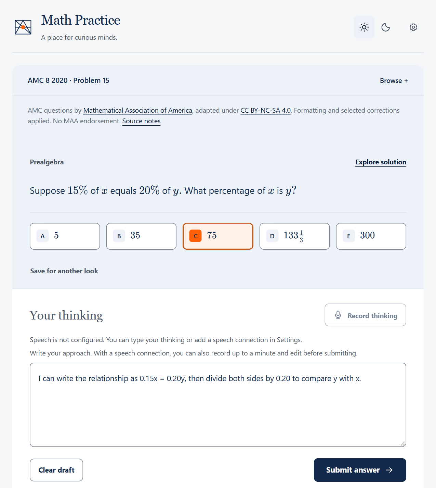
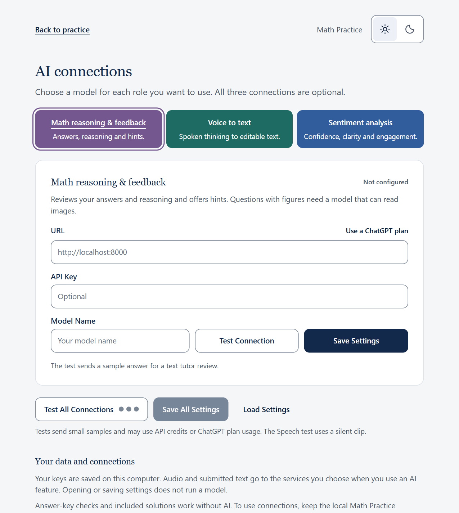

# Math Practice UI 2.2.0

**[Open Math Practice online](https://math-practice.ailleo.net/)** to practice 8,790 questions. Choose **Try a problem** for a starting question, or **Browse** to pick a contest, curriculum topic, or mathematical idea.

| Practice a question | Configure the three model roles |
|:---:|:---:|
| [](images/question-page.png) | [](images/model-settings.png) |

## Start practicing

The online edition needs only a browser and an internet connection. It downloads a browsing index, then loads each question, its worked methods, and any figures you open. Type your answer and reasoning, submit to check supported answers against the key, or open **Explore solution** to read a method. Drafts and saved problems stay in that browser.

For an app icon, use your browser’s **Install** option where available. On iPhone, open the site in Safari and choose **Share → Add to Home Screen**. New questions still load online.

## Connect your tutor online

Open **Settings → Model settings**. Settings opens over the current problem, so your draft and any pending response remain in place.

- **Custom API:** enter your own OpenAI-compatible API base URL, API key if required, and model. Save and test the connection. Requests go directly from the browser to that provider. The provider must allow browser requests from this site (CORS). A successful text test does not verify image support; choose a model that can read images for figure questions.
- **ChatGPT account: Forthcoming.** Online sign-in is not available in this release.

API keys remain in the current browser tab session, including its settings frame. Nonsecret preferences can persist between visits. Provider charges and data-use policies apply. Your tutor requests do not pass through the site operator's desktop.

Ailleo speech-to-text and D3 are separate optional services. They remain **Not connected** until their public gateway and frontend adapter are ready. The desktop programmer's remaining work is in [the service connection handoff](../DESKTOP_SERVICES_CONNECT.md).

## Run locally

Choose the local edition for offline practice, your own question banks, or your own speech and learning-signal connections.

1. Install Python **3.11 or newer** on your computer. [Download Python](https://www.python.org/downloads/)
2. Download the project ZIP, extract it, and open the **K-12-math-main** folder. [Download the project ZIP](https://github.com/rqzhu-aide/K-12-math/archive/refs/heads/main.zip)
3. **On Windows**, double-click **Start Math Practice.cmd**. The launcher opens the practice page in your browser. **On macOS or Linux**, open a terminal in the extracted folder and run `python3 math-practice/runtime/serve_math_practice.py`. Keep the terminal open and visit [Math Practice on this computer](http://127.0.0.1:8877/math-practice/).

The first launch builds a search index from the included banks and can take a few minutes. Basic practice uses Python’s standard library. To connect a tutor, follow the steps below.

## Use your own question bank

Use the [question-bank template](../question-bank-template/README.md) to process your
own questions into the shared JSON format, then use the Math Practice UI to serve
and practice the processed questions. The template includes schemas, four example
questions, a diagram, and a conversion guide. Preserve each question's answer,
worked solution, figures, and source attribution when preparing your collection.
The [explanation style guide](../question-bank-template/EXPLANATION_STYLE.md) helps
authors turn correct solutions into connected, student-facing reasoning.

From the repository root, replace `path/to/your-bank` with your prepared bank
folder and run:

```sh
python math-practice/runtime/import_question_bank.py path/to/your-bank --check
python math-practice/runtime/import_question_bank.py path/to/your-bank
python math-practice/runtime/serve_math_practice.py
```

The importer validates the prepared JSON and referenced figures, then generates
the UI data and backend reference records. It does not extract questions from
PDFs or other raw sources. Open [Math Practice](http://127.0.0.1:8877/math-practice/)
and select your bank to browse questions, submit answers, and explore included solutions.
Ordinary practice works without models; configured models add the same optional
speech input and AI feedback available for the included bank.

To try the supplied examples, use `question-bank-template/example` as the bank
folder. Add `--replace` when importing an updated version of an existing bank,
then reload practice. Imported banks stay in ignored `custom-banks/`; importing
does not publish your collection or change its license. See the template guide
for conversion details and answer-checking limits.

## Optional AI connections

The connections below apply to the **local edition**. For the public website, use the [online custom API setup](#connect-your-tutor-online); online ChatGPT sign-in is forthcoming. The local Python server on your computer handles model requests, API keys, and ChatGPT sign-in. [OpenAI API authentication](https://developers.openai.com/api/reference/overview#authentication)

Open the local app’s **Settings → Connection settings → Math reasoning & feedback** and choose how to connect.

| Connection | Steps |
|---|---|
| **ChatGPT plan** | Install the shared sign-in dependency with `python -m pip install --user "PyJWT[crypto]>=2.10,<3"` (use `python3` on macOS or Linux). Choose **Use a ChatGPT plan → Continue with ChatGPT**. Sign in to an eligible account, return to the app, and choose a model. [OpenAI local-app sign-in guide](https://developers.openai.com/siwc/token-sharing-open-source/sign-in) |
| **OpenAI API key** | In the custom API form, enter `https://api.openai.com/v1` under **URL**, paste your own project key under **API Key**, and enter the name of a Chat Completions model your API project can use. [Create an OpenAI API key](https://platform.openai.com/api-keys) |

Choose **Test Connection**, then **Save Settings**. A successful math test returns a tutor review. Tests send a small sample and use the selected API or plan. You can leave the other two roles blank or connect your own models below.

### Separate and local connections

Open **Settings → Connection settings**. Each connection is independent. Enter
your server address and model ID, add a key only if your server requires one,
then save and test that connection. Leave its address and model blank to disable it.

| Connection | Adds | Required API |
| --- | --- | --- |
| Math reasoning and feedback | Reviews the submitted answer and explanation in one call, with feedback and a hint when needed | Compatible `POST /v1/chat/completions` returning a structured tutor review, or a supported account connection |
| Voice to text | Turns recorded thinking into an editable transcript | `POST /v1/audio/transcriptions` accepting multipart WAV and returning a text field |
| Sentiment analysis | Reads the original transcript for expressed confidence, engagement, and how clearly the student explained their reasoning; this does not require the reasoning to be correct | Compatible `POST /v1/chat/completions` with JSON responses, or custom `POST /v1/systemone` with rubric choices and probabilities |

Model listing through `GET /v1/models` is optional. The connection tests call
the task endpoints directly. Sentiment analysis uses the words in the original
speech transcript. The math tutor uses the thinking the student submits, including
any edits they make before submitting.

Use an address such as `http://localhost:8000` and the model ID reported by your
own server. An address ending in `/v1` is also accepted. New text connections use
compatible chat APIs. Existing custom `/v1/systemone` connections keep their saved
format; it can also be set with `decision.protocol: "systemone"` in `config.json`.

Deeper review of questions with figures also needs an inference model that accepts
image content. Install its image helpers in your shared Python installation:

```sh
python -m pip install --user PyMuPDF Pillow
```

Figures with even-odd clipping also use an existing system or user installation of
Chrome, Chromium, or Edge. This preserves white holes and overlapping outlines in
the image sent to the tutor. The app does not download a browser.

ChatGPT plan credentials are stored in the app’s user-data
directory. Existing **Codex account** connections continue to use the user's
Codex installation, login, and shared `openai-codex` Python package.

Settings are stored in ignored `math-practice/config.json`. The server creates
it with empty connections on first start. You may also copy
`math-practice/config.example.json` to that path and edit it, then use
**Load Settings**. The example contains no working credentials or private
addresses. Startup does not run model tests or inference.

You can load a separate private JSON or YAML profile at startup:

```sh
python math-practice/runtime/launch_math_practice.py --settings "path/to/setting.yaml" --port 8879
```

The server also accepts `--settings`. **Load Settings** reloads that selected file;
**Save Settings** updates it. YAML profiles use the same `decision`, `speech`,
and `inference` sections as JSON and require shared **PyYAML**
(`python -m pip install --user PyYAML`). A connection may use
`apiKeyFile: api_key.txt`, resolved relative to the profile, instead of embedding
its key. Unchanged key-file references are preserved when saving.

New installations use `mathAssessment: inference`: the math tutor checks the
answer and reasoning and returns its feedback and any hint in one inference.
Exact answer-key checks still work locally without a model. An existing profile
that omits `mathAssessment` or explicitly sets it to `decision` keeps the older
separate math check. Set it to `inference` to use the new routing with that profile.
For an existing Codex account, use `inference.provider: codex`
with its model and effort; account credentials remain in the existing user-wide
sign-in. Private profiles and `local-service/` are Git-ignored. A launcher will not
reuse a running server with a different profile; choose another port or restart it.

## Updating the hosted site

The hosted edition is published from the root of the `gh-pages` branch. Run these
PowerShell commands from the repository root with shared installations of Python
3.11 or newer, Node.js, and Git. Each update uses a new output folder outside
the checkout.

```powershell
node --test scripts/test_hosted_runtime.js scripts/test_agreement.js
if ($LASTEXITCODE -ne 0) { throw 'Hosted practice tests failed.' }
python scripts/test_pages_export.py
if ($LASTEXITCODE -ne 0) { throw 'Pages export tests failed.' }
$pagesOutput = Join-Path (Split-Path -Parent $PWD.Path) ("K-12-math-pages-" + (Get-Date -Format yyyyMMdd-HHmmss))
$pagesWorktree = "$pagesOutput-branch"
python scripts/build_pages.py --output $pagesOutput
if ($LASTEXITCODE -ne 0) { throw 'The site export failed.' }
```

The export validates the public question and graph bindings, then writes the app,
browsing catalogs, individual questions, practice links, figures, and source
notices. Preview or inspect that folder before publishing. The exporter requires
an empty output folder and leaves the source checkout unchanged.

Prepare the update in a separate worktree of the published branch. The `git rm`
command clears the previously tracked website files in that worktree so that the
published branch also reflects removals from the collection.

```powershell
git fetch origin gh-pages
git worktree add --detach $pagesWorktree origin/gh-pages
if ($LASTEXITCODE -ne 0) { throw 'Could not prepare the deployment worktree.' }
git -C $pagesWorktree rm -qr --ignore-unmatch .
Get-ChildItem -LiteralPath $pagesOutput -Force | Copy-Item -Destination $pagesWorktree -Recurse -Force
git -C $pagesWorktree add --all
git -C $pagesWorktree diff --cached --stat
```

After reviewing the changes, publish the commit and remove the temporary worktree.

```powershell
git -C $pagesWorktree commit -m "Update hosted Math Practice"
git -C $pagesWorktree push origin HEAD:gh-pages
if ($LASTEXITCODE -ne 0) { throw 'Push failed. The worktree is available for retry.' }
git worktree remove $pagesWorktree
```

In GitHub **Settings → Pages**, the source is **Deploy from a branch**, with
`gh-pages` and **/(root)** selected. GitHub publishes each update to that branch. Check the published
[Math Practice site](https://math-practice.ailleo.net/) after deployment.

### Connect the Squarespace domain

The public app uses **https://math-practice.ailleo.net/**. Squarespace continues
hosting **ailleo.net** and **www.ailleo.net**. A separate subdomain does not need
a URL redirect, a Squarespace page, or Cloudflare routing.

1. In [GitHub Pages settings](https://github.com/rqzhu-aide/K-12-math/settings/pages),
   use **Deploy from a branch**, **gh-pages**, and **/(root)**. Set **Custom domain**
   to `math-practice.ailleo.net`, without `https://` or a path. Configure the GitHub
   side before adding its DNS record.
2. In the Squarespace domains dashboard, select **ailleo.net**, open **DNS**, and
   add this custom record:

   | Field | Value |
   | --- | --- |
   | Type | CNAME |
   | Host / Name | `math-practice` |
   | Data / Alias | `rqzhu-aide.github.io` |
   | TTL | Default |

   The target contains no scheme, repository name, or path. Leave the existing
   apex (`@`), `www`, email, and verification records in place. If the exact
   `math-practice` name already has a conflicting record, inspect that record
   before replacing it.
3. After DNS propagates, GitHub provisions the HTTPS certificate. Return to
   GitHub Pages settings and enable **Enforce HTTPS** when available. Open
   `https://math-practice.ailleo.net/` to check the agreement, a question, a figure,
   and a worked solution. Squarespace advises allowing up to 24 to 48 hours for
   DNS changes; GitHub says HTTPS availability can take up to 24 hours.

The app opens at the site root. Old `/math-practice/` links redirect to the root
and retain their query and fragment. The source repository's `CNAME` file is
copied into the exported site so subsequent updates preserve the domain.
The exporter's `--custom-domain` option can override that source setting.

The publication includes question banks, answer-key checks, available worked solutions,
browser-local drafts, and online tutor settings for the learner's own API URL,
key, and model. ChatGPT account sign-in is forthcoming; its helper and setup guide
are not included in the hosted build. Publishing the site does not activate the
separate desktop speech/D3 gateway.

References: [Squarespace DNS settings](https://support.squarespace.com/hc/en-us/articles/360002101888-Edit-your-domain-s-DNS-records),
[GitHub Pages custom domains](https://docs.github.com/en/pages/configuring-a-custom-domain-for-your-github-pages-site/managing-a-custom-domain-for-your-github-pages-site).
