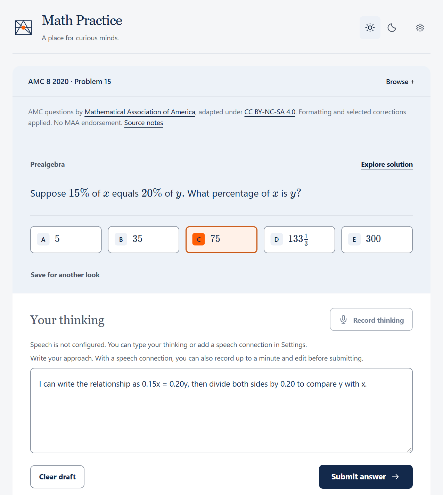
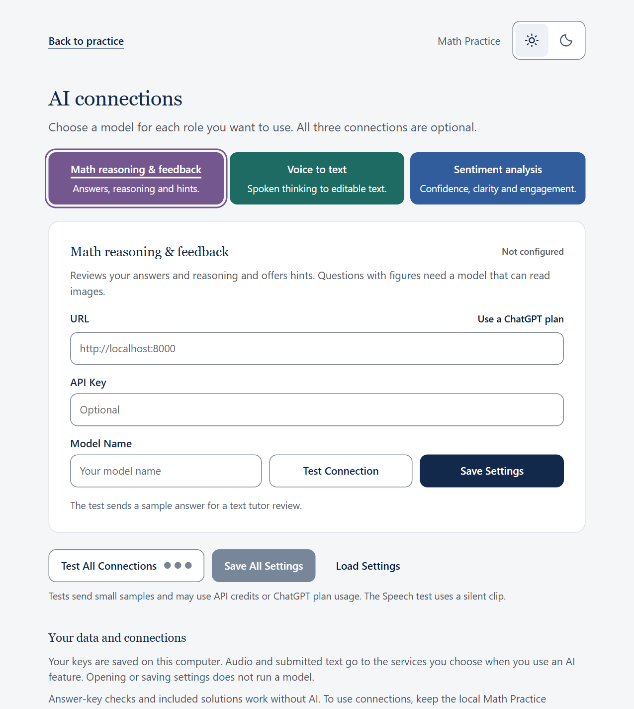

# Math Practice UI 2.1.3

Browse questions, record or type your thinking, and ask for feedback or a hint.

| Practice a question | Configure the three model roles |
|:---:|:---:|
| [](images/question-page.png) | [](images/model-settings.png) |

## Start practicing

Install **Python 3.11 or newer** for your user or machine. No Python packages or
model services are needed for ordinary practice.

On first start, the server creates its default connection settings and builds the
local SQLite knowledge database from the bundled source records. A fresh checkout
does not need an existing `.local/` folder, database file, or private model profile.

From this repository's root, run:

```sh
python math-practice/runtime/serve_math_practice.py
```

Open [Math Practice](http://127.0.0.1:8877/math-practice/). Keep the terminal running.
On Windows, you can instead double-click **Start Math Practice.cmd** to start the
server in the background and open practice. If the port is occupied, add
`--port 8878` to the Python command and use that port in the browser.
After updating the repository, stop and restart any running Math Practice server
so it can serve newly added banks and official solution booklets.

Choose **Try a problem** or browse by level, unit, and topic. Enter an answer,
write your thinking, and submit. Without models, known answers are checked
locally; reasoning and unfamiliar symbolic or open answers are not automatically
judged. Add some thinking to open the answer and available solution. Drafts and your notebook
stay in the browser. Opening `math-practice/index.html` directly also supports
practice without model services; microphone input needs the local server.

## Use your own question bank

Use the [question-bank template](../question-bank-template/README.md) to process your
own questions into the shared JSON format, then use the Math Practice UI to serve
and practice the processed questions. The template includes schemas, four example
questions, a diagram, and a conversion guide. Preserve each question's answer,
worked solution, figures, and source attribution when preparing your collection.
The [explanation style guide](../question-bank-template/EXPLANATION_STYLE.md) helps
authors turn correct solutions into connected, student-facing reasoning.

From the repository root, replace `path/to/your-bank` with your prepared bank
folder and run:

```sh
python math-practice/runtime/import_question_bank.py path/to/your-bank --check
python math-practice/runtime/import_question_bank.py path/to/your-bank
python math-practice/runtime/serve_math_practice.py
```

The importer validates the prepared JSON and referenced figures, then generates
the UI data and backend reference records. It does not extract questions from
PDFs or other raw sources. Open [Math Practice](http://127.0.0.1:8877/math-practice/)
and select your bank to browse questions, submit answers, and explore included solutions.
Ordinary practice works without models; configured models add the same optional
speech input and AI feedback available for the included bank.

To try the supplied examples, use `question-bank-template/example` as the bank
folder. Add `--replace` when importing an updated version of an existing bank,
then reload practice. Imported banks stay in ignored `custom-banks/`; importing
does not publish your collection or change its license. See the template guide
for conversion details and answer-checking limits.

## Optional AI connections

Open **Settings → Connection settings** to choose a model for each task. For
example, you can connect your OpenAI account for math reasoning and feedback,
and use local models for voice to text and sentiment analysis. With a custom API,
enter the service URL and model name, and a key if the service requires one.
You can leave any role unconfigured. Existing connections load into their tabs.

Use **Test All Connections** to check the configured features before saving.
Each colored dot means that tab passed its sample task. If a dot is gray, open
the matching tab to see its status. Tests use synthetic samples, including a
short silent recording, and may use API credits. Ordinary practice needs no API key.

### Separate and local connections

Open **Settings → Connection settings**. Each connection is independent. Enter
your server address and model ID, add a key only if your server requires one,
then save and test that connection. Leave its address and model blank to disable it.

| Connection | Adds | Required API |
| --- | --- | --- |
| Math reasoning and feedback | Reviews the submitted answer and explanation in one call, with feedback and a hint when needed | Compatible `POST /v1/chat/completions` returning a structured tutor review, or a supported account connection |
| Voice to text | Turns recorded thinking into an editable transcript | `POST /v1/audio/transcriptions` accepting multipart WAV and returning a text field |
| Sentiment analysis | Reads the original transcript for expressed confidence, engagement, and how clearly the student explained their reasoning; this does not require the reasoning to be correct | Compatible `POST /v1/chat/completions` with JSON responses, or custom `POST /v1/systemone` with rubric choices and probabilities |

Model listing through `GET /v1/models` is optional. The connection tests call
the task endpoints directly. Sentiment analysis uses the words in the original
speech transcript. The math tutor uses the thinking the student submits, including
any edits they make before submitting.

Use an address such as `http://localhost:8000` and the model ID reported by your
own server. An address ending in `/v1` is also accepted. New text connections use
compatible chat APIs. Existing custom `/v1/systemone` connections keep their saved
format; it can also be set with `decision.protocol: "systemone"` in `config.json`.

Deeper review of questions with figures also needs an inference model that accepts
image content. Install its image helpers in your shared Python installation:

```sh
python -m pip install --user PyMuPDF Pillow
```

Figures with even-odd clipping also use an existing system or user installation of
Chrome, Chromium, or Edge. This preserves white holes and overlapping outlines in
the image sent to the tutor. The app does not download a browser.

In the math tab, choose **Use a ChatGPT plan** to connect an eligible plan.
**Continue with ChatGPT** opens OpenAI's sign-in page. After granting access,
choose a model, run **Test Connection**, then **Save Settings**. A passing
math test means the model returned a valid text tutor review. Figure
questions also require image support. Use **Manage usage** to check plan limits,
or **Use custom API** to switch back. Voice to text and sentiment analysis use their own endpoints.
[OpenAI's local-app sign-in guide](https://developers.openai.com/siwc/token-sharing-open-source)

ChatGPT sign-in uses the shared Python package `PyJWT[crypto]`. Install it once
with `python -m pip install --user "PyJWT[crypto]>=2.10,<3"`. Account credentials
are stored separately from the practice configuration, in the app's user-data
directory. Existing **Codex account** connections continue to use the user's
Codex installation, login, and shared `openai-codex` Python package.

Settings are stored in ignored `math-practice/config.json`. The server creates
it with empty connections on first start. You may also copy
`math-practice/config.example.json` to that path and edit it, then use
**Load Settings**. The example contains no working credentials or private
addresses. Startup does not run model tests or inference.

You can load a separate private JSON or YAML profile at startup:

```sh
python math-practice/runtime/launch_math_practice.py --settings "path/to/setting.yaml" --port 8879
```

The server also accepts `--settings`. **Load Settings** reloads that selected file;
**Save Settings** updates it. YAML profiles use the same `decision`, `speech`,
and `inference` sections as JSON and require shared **PyYAML**
(`python -m pip install --user PyYAML`). A connection may use
`apiKeyFile: api_key.txt`, resolved relative to the profile, instead of embedding
its key. Unchanged key-file references are preserved when saving.

New installations use `mathAssessment: inference`: the math tutor checks the
answer and reasoning and returns its feedback and any hint in one inference.
Exact answer-key checks still work locally without a model. An existing profile
that omits `mathAssessment` or explicitly sets it to `decision` keeps the older
separate math check. Set it to `inference` to use the new routing with that profile.
For an existing Codex account, use `inference.provider: codex`
with its model and effort; account credentials remain in the existing user-wide
sign-in. Private profiles and `local-service/` are Git-ignored. A launcher will not
reuse a running server with a different profile; choose another port or restart it.
